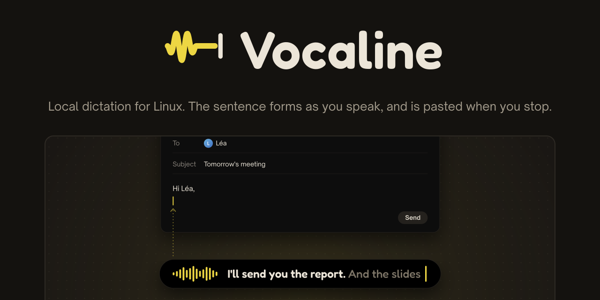
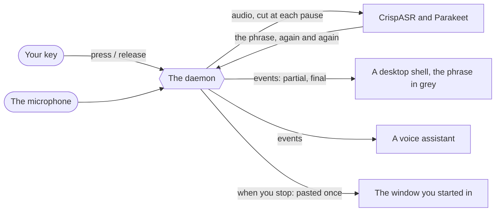

<div align="center">



</div>

## What it is

Local dictation for Linux (Wayland, Hyprland), written in Rust.

While you speak, you watch the phrase form: it shows in grey while the model still hesitates, and
freezes at each pause. When you stop, the whole dictation is pasted once, in the window you
started in. The model is NVIDIA's Parakeet TDT 0.6B v3, run by
[CrispASR](https://github.com/CrispStrobe/CrispASR) on the GPU when there is one, on the CPU
otherwise. Three rules shape it:

- **Nothing leaves the machine.** No account, no server, no telemetry. What you dictate is kept
  only where you ask for it (`vocaline last`, in memory), and the statistics count words, never
  store them.
- **The GPU is borrowed, not taken.** The model is loaded when you start speaking (about 0.4 s,
  and what you say meanwhile is kept) and unloaded when you stop: between two dictations,
  Vocaline holds no video memory at all. When the GPU is full, the dictation is decoded on the
  CPU instead of being lost.
- **Vocaline grabs no key and draws nothing.** A daemon owns the microphone and the engine, and
  publishes what it hears as an event stream. Your desktop binds a key to `vocaline press` and
  `vocaline release`; a bar, a notification or a voice assistant reads the stream and shows the
  phrase being spoken, or only listens.

## How it works



1. **You press the key.** Hold it while you speak and release it, or tap it once to start and
   once to stop. The microphone opens at once; the model loads behind it.
2. **The phrase forms.** A voice detector (Silero VAD) cuts the speech at each pause. The open
   phrase is decoded again every 400 ms: a `partial`, the grey text. After 700 ms of silence it
   is decoded a last time and frozen: a `final`.
3. **Your words are fixed.** Your own vocabulary corrects the names the model gets wrong, the
   filler words (`euh`, `um`) go, and the phrases a pause cut in the middle of a sentence are
   joined again.
4. **It is pasted where you were.** When you stop, the dictation goes through the clipboard into
   the window that had the focus when you started, and your clipboard is given back, with
   everything it held, once the application has read it. A rule per application can press Enter
   after it, drop the final period, or paste nothing.

## Install

On Arch Linux, each release carries a package (`vocaline-<version>-1-x86_64.pkg.tar.zst`) with
Vocaline, a systemd user service and its own build of CrispASR, CUDA and CPU in the same binary:

```sh
sudo pacman -U vocaline-*.pkg.tar.zst
vocaline setup                                   # downloads the models, their size shown first
systemctl --user enable --now vocaline.service
```

`vocaline setup` picks the model for the machine: Parakeet q8_0 (674 MB) on an NVIDIA GPU, a
lighter q4_k with a slower grey text on the CPU. Then bind a key, on Hyprland:

```
bind = SUPER, A, exec, vocaline press
bindr = SUPER, A, exec, vocaline release
```

The package, the models, the engine's patch and building it yourself:
[`docs/install.md`](docs/install.md).

## The pieces

- **The daemon** (`vocaline daemon`, or the service): owns the microphone (PipeWire) and runs
  one CrispASR per dictation. Its commands, the key and the paste:
  [`docs/usage.md`](docs/usage.md).
- **The event stream** (`vocaline watch`, or the socket `$XDG_RUNTIME_DIR/vocaline.sock`): one
  JSON object per line, a versioned contract for every program that reads it:
  [`docs/events.md`](docs/events.md).
- **What makes it yours**: the configuration per machine (model, backend, cadence), your
  vocabulary (`vocaline teach "foo bar" "Foobar"`), the rules per application, the filler words
  and the statistics (`vocaline stats`): [`docs/configuration.md`](docs/configuration.md).

## Contributing

[`AGENTS.md`](AGENTS.md) says how the repository works, for people and for coding agents.

## Licence and credits

Free software under the [Apache License 2.0](LICENSE) ([`NOTICE`](NOTICE)). The package bundles
[CrispASR](https://github.com/CrispStrobe/CrispASR) (MIT) with Vocaline's own patch. The models
are downloaded by `vocaline setup` and are not part of Vocaline: Parakeet TDT 0.6B v3 by NVIDIA
(CC-BY-4.0), as GGUF files from [cstr/parakeet-tdt-0.6b-v3-GGUF](https://huggingface.co/cstr/parakeet-tdt-0.6b-v3-GGUF),
and Silero VAD (MIT), from [ggml-org/whisper-vad](https://huggingface.co/ggml-org/whisper-vad).

The logo and the banner are in [`assets/brand`](assets/brand/README.md); the banner is drawn in
Fredoka, Open Sauce Sans and JetBrains Mono, under the SIL Open Font License 1.1
([`assets/brand/fonts`](assets/brand/fonts/README.md)).
